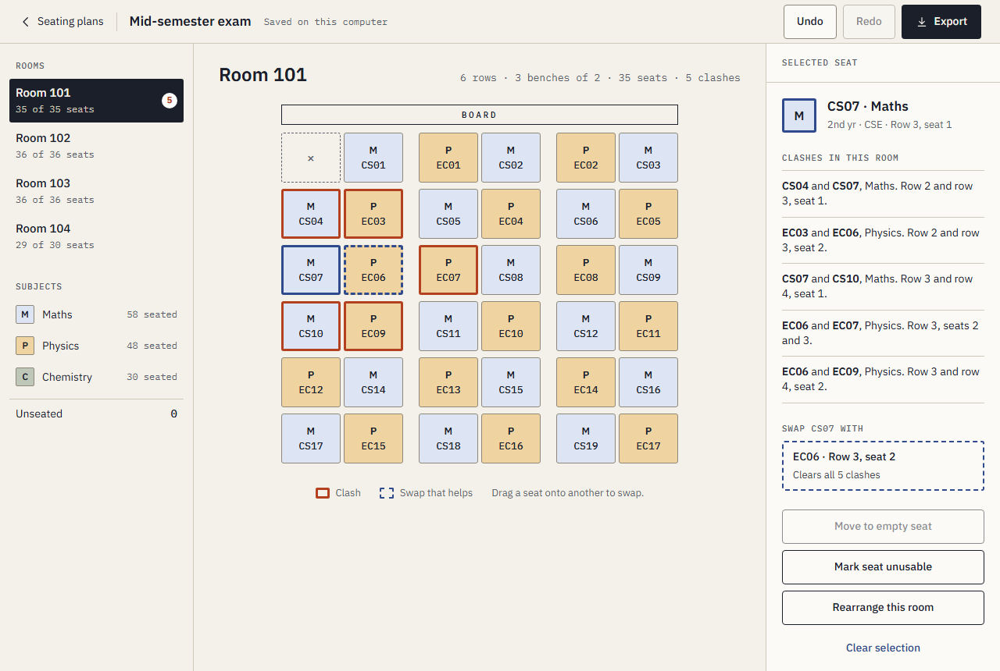
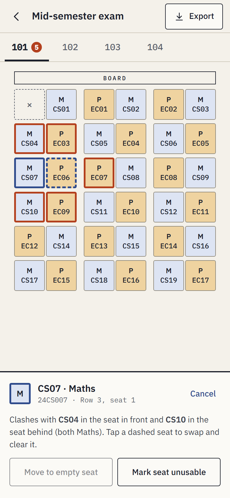
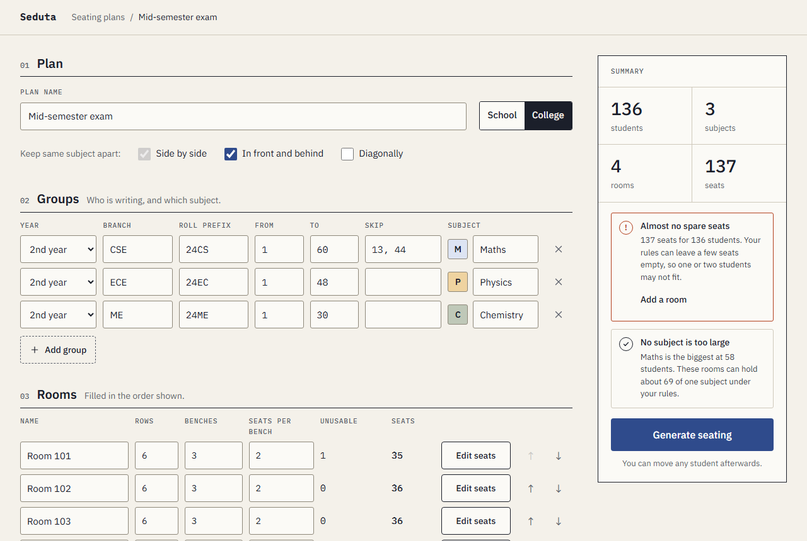

# Seduta

Seat students in exam rooms so that nobody sits next to a student writing the same subject. Built for teachers and exam coordinators at schools and colleges, mostly on a phone, sometimes on a desktop.

You enter **roll number ranges** (not student lists), describe your **rooms**, and Seduta generates a seating plan. You fix anything by hand, then export a **PDF** of the seat layout (one page per room) and a **Word** table of which roll numbers sit in which room.

|                                                        |                                                             |
| ------------------------------------------------------ | ----------------------------------------------------------- |
|  |  |



## What it does

- **Plan** in four steps on a phone (setup, groups, rooms, review), or all on one page on a desktop.
- **Same data for schools and colleges.** Only the labels change: Year and Branch, or Class and Section.
- **Choose the rules:** keep the same subject apart side by side (always), in front and behind, and diagonally.
- **Warns before generating** when the rooms can't work (too few seats, one subject too big for the rooms, almost no spare seats).
- **Never breaks the rule silently.** If a seat can't be filled safely it stays empty and the leftover students are listed.
- **Edit by hand:** tap two seats to swap, or drag one onto another on a desktop. Clashes turn red, suggested swaps are dashed, and Undo and Redo work. "Rearrange this room" re-seats one room.
- **Export** a PDF (A4 or Letter, readable in greyscale) and a Word document.
- **Local-first.** Everything stays on the device in the browser's storage. There is no account and no server. It works offline once installed.
- **Backup and restore** to a JSON file from the saved plans page, because clearing site data would delete your plans.
- **Light and dark** themes, following the system by default.

## Run it

Needs Node 20.9 or newer.

```bash
npm install
npm run dev        # http://localhost:3000
```

| Command               | What it does                                          |
| --------------------- | ----------------------------------------------------- |
| `npm run dev`         | Development server (the offline worker is off in dev) |
| `npm run build`       | Production build                                      |
| `npm start`           | Serve the production build                            |
| `npm run lint`        | ESLint                                                |
| `npm run typecheck`   | TypeScript                                            |
| `npm test`            | Unit tests (Vitest)                                   |
| `npm run e2e:install` | Download the browser Playwright uses                  |
| `npm run e2e`         | End-to-end tests on a phone and a desktop viewport    |
| `npm run format`      | Prettier                                              |

Make the README pictures again with `SCREENSHOTS=1 npx playwright test e2e/screenshots.spec.ts`.

## How it is built

Next.js (App Router) and TypeScript, Tailwind with CSS-variable theme tokens, IndexedDB through Dexie, Zustand for the editor's undo history, `pdf-lib` and `docx` for exports (all generated in the browser), dnd-kit for drag and drop, Vitest and Playwright for tests.

```
src/lib/seating/   The seating engine. Pure TypeScript: no React, no browser APIs.
src/lib/db/        Dexie storage: plans and saved rooms.
src/lib/editor/    Edit operations, undo/redo history and the editor store.
src/lib/export/    PDF and Word generation.
src/components/    UI. components/ui holds the shared pieces, SeatGrid is used everywhere.
src/app/           Screens. Each is a static page that takes the plan as ?plan=…
e2e/               Playwright tests.
```

A few decisions worth knowing:

- **The engine** (`src/lib/seating/seating.ts`) walks seats row by row and places the subject with the most students left that doesn't clash with a seat already filled. It is deterministic: the same input always gives the same layout.
- **Every screen is a static page** (`/setup?plan=…`, not `/plan/…/setup`). Static pages can be saved by the service worker, which is what makes airplane mode work, and the app has no server code at all.
- **Colour is never the only signal.** Every seat shows its subject letter; clashes also get a thick border.
- **Contrast is tested.** `src/lib/contrast.test.ts` reads the colour tokens and checks 4.5:1 for text in both themes.

## Offline and installing

In a production build, the app registers a small service worker (`/sw.js`) that saves every page and its scripts on the first visit. After that it opens without a network, and it can be installed to the home screen from the browser menu. The worker is off in development so you never see stale files. `e2e/offline.spec.ts` checks the whole job in airplane mode.

## Deploying

There is no backend and no environment variable. Any host that can run a Next.js app works. On Vercel, import the repository and accept the defaults. Because the app has no server code, `output: "export"` in `next.config.ts` should also let it be served as plain files from any static host, but that has not been tried here.

## Limits

- **Roll numbers are a prefix plus a number** (for example `24CS` and 1 to 60). If a college uses another format, add a second group for that series.
- **PDF text is Latin only.** The PDF uses the standard built-in fonts, so plan names in other scripts print as `?`. The Word file has no such limit.
- **Data lives in one browser.** Plans don't sync between devices. Use Backup and Restore to move them.
- Not included: accounts, cloud sync, sharing links, student names, invigilator duty allocation, timetables.
